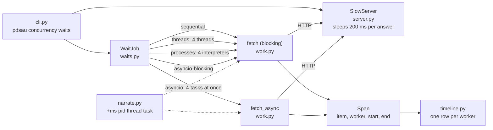
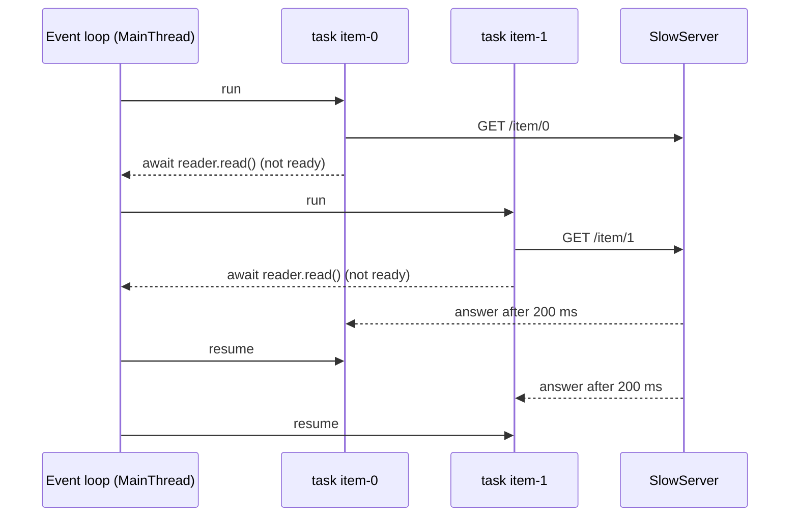

# The waiting lab: one job, five ways to wait

PR: https://github.com/bhavya94/python-data-structures-and-utilities/pull/1

## Summary

A program that waits on the network can wait for many things at once, but only if something lets it. This PR
builds a lab that makes those waits visible. It starts a slow web server on this machine and sends it 8
requests, each answered after 200 ms. It sends them five ways: one at a time, from threads, from processes,
from asyncio tasks, and from asyncio tasks that make the classic mistake of a blocking call. Every log line names
its process, thread and task, and each way ends with a timeline and a predicted time next to the measured one.

## The map



`narrate.py` sits under everything. It formats every log line with the elapsed time, the process ID, the thread
and the asyncio task. That one format is what lets you see concurrency in the output.

## Start with something familiar

Picture a café with 8 orders and a coffee machine that takes 200 ms per cup (the slow server).

- **One barista, one cup at a time** (sequential): 8 × 200 = 1,600 ms.
- **Four baristas** (threads): each starts a cup, and all four machines run at once. Two rounds: 400 ms.
- **Four baristas from another café** (processes): just as fast once they arrive, but they take about 100 ms to
  arrive and set up.
- **One barista with four timers** (asyncio): starts four cups, does nothing while they brew, and picks up each
  when it beeps. Two rounds again: 400 ms, with one person.
- **One barista who stares at each cup until it's done** (asyncio with a blocking call): 1,600 ms again. Having
  timers doesn't help if you never look away.

## Words to know

- **Thread:** a line of work inside one process, sharing the process's memory.
- **Process:** a separate running program with its own memory and its own Python interpreter.
- **GIL** (global interpreter lock): in the standard CPython build, only the thread holding it runs Python code.
  A thread releases it while it waits on a socket. That is why threads help here: the work is all waiting.
- **Event loop:** asyncio's scheduler. It runs many tasks on one thread and switches whenever a task reaches
  `await` on something that isn't ready.
- **Blocking call:** a call that keeps the thread until it returns, like `urlopen`. Inside a coroutine it stops the
  loop from switching.
- **Pickle:** turning an object into bytes. A process pool pickles each task (function and arguments) to send it
  to a worker, and pickles the result back.

## How it works, stage by stage



1. **The server** (`server.py`) is a `ThreadingHTTPServer` on 127.0.0.1, on a port the OS picks. It answers
   each request on its own thread and sleeps 200 ms first. So the server can always hold every wait at once,
   and any limit you see is the client's.
2. **The unit of work** (`work.py`) comes in two forms. `fetch` uses `urlopen` and blocks its thread.
   `fetch_async` writes a raw HTTP/1.0 request with `asyncio.open_connection` and awaits the answer. Both return
   a `Span`: the item, who ran it, and the wall-clock start and end.
3. **The job** (`waits.py`) runs the five ways:
   - `threads` uses a `ThreadPoolExecutor` with 4 threads named `worker_0` to `worker_3`.
   - `processes` uses a `ProcessPoolExecutor` with 4 workers. Its initializer calls `narrate.setup` with the
     parent's start time. A spawned process starts as a fresh interpreter with no logging set up, so without
     this its lines would be silent or out of step.
   - `asyncio` starts 8 tasks in a `TaskGroup`, and a `Semaphore(4)` keeps 4 requests in flight at most.
   - `asyncio-blocking` is the same, except each task calls the blocking `fetch`.
4. **The model** (`WaitJob.predict`) fills in the cost model's formulas with this run's numbers. For processes,
   S can't be known in advance, so it uses the measured time before the first request.
5. **The timeline** (`timeline.py`) draws one row per worker and marks each span with its item's digit.

## A real run

```console
way               model                                         predicted  measured
threads           ⌈n/N⌉·t = ⌈8/4⌉·200 = 2·200                      400 ms    420 ms
processes         S + ⌈n/N⌉·t = 109 + ⌈8/4⌉·200                    509 ms    573 ms
asyncio-blocking  n·t = 8·200                                     1600 ms   1656 ms
```

Where the numbers come from:
- n = 8 requests, t = 200 ms, N = A = 4 workers. ⌈8 / 4⌉ = 2 rounds, and 2 × 200 = 400 ms.
- Each measured request took 205 to 221 ms. The extra few ms per request is the socket and HTTP work, which the
  model leaves out. Two rounds of that explain most of 420 − 400.
- For processes, the first request went out 109 ms after the run began. That is S: starting 4
  interpreters and importing this package in each. The pool then took 38 ms to shut its workers down, which the
  summary reports separately. With the per-request overhead, that accounts for 573 − 509 = 64 ms.

## Decision log

| Decision | Options considered | Chosen | Why |
|---|---|---|---|
| What the wait is | `time.sleep` in the client; a real server | A real local HTTP server | A socket wait is what threads and asyncio are for. A client-side sleep would hide the GIL release and the event loop's socket readiness. |
| Async HTTP client | aiohttp or httpx; raw `asyncio.open_connection` | Raw streams, HTTP/1.0 | No dependency, and every `await` is visible in 10 lines. HTTP/1.0 means the server closes the connection, so `read()` ends cleanly. |
| How to narrate | `print` in each function; `logging` with a custom format | `logging`, set up once in `narrate.py` | One format carries pid, thread and task on every line. `-v` and `-q` change the level, not the code. Only the CLI prints results. |
| Time base | `time.perf_counter`; `time.time` | `time.time` | Worker processes must line up with the parent. Every process reads the same wall clock. |
| Asyncio limit | unbounded; `Semaphore(N)` | `Semaphore(N)` | The same limit as the thread and process pools, so the five ways compare fairly. |
| Processes model | leave S out; guess S; measure S | Measure S | S depends on the machine and the imports. The lab shows its real size. |
| Package name | short `pdsu`; the template's full name | Full name, command `pdsau` | `new-project.py` derives both from the repo name. All the other repos follow it. |

Revisit the raw HTTP client if a later lab needs keep-alive or many hosts.

## Cost and risk

- No API calls and no cost. A full run takes about 5 seconds.
- Timing tests can flake on a busy machine. They check the shape with wide margins: under 2 rounds for
  overlap, at least n · t for one at a time.
- `ProcessPoolExecutor` uses the spawn start method on macOS, so each worker imports the package fresh. Spawn
  passes the parent's `sys.path` to each worker, so a worker imports the package the same way the parent did.

## Open questions

- None for this PR. The compute lab (CPU work with and without the GIL, on Python 3.14 and the free-threaded
  3.14t) is next.
